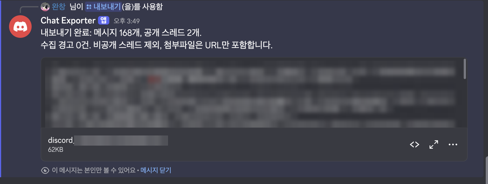

# Discord Chat Exporter

서버 전용 `/내보내기` 명령어로 현재 채널 또는 지정한 텍스트 채널과, 접근 가능한 활성·보관된 공개 스레드를 JSON으로 내보냅니다.
비공개 스레드는 제외하고 첨부파일은 URL만 기록합니다. 결과 파일은 명령어 실행자에게만 보이는 비공개 응답으로 전달됩니다.



실제 서버에서 실행한 결과입니다(2026-11-02). JSON 미리보기와 채널 ID는 가렸습니다.

## 사용법

```
/내보내기 [채널] [시작] [끝] [요약]
```

모든 옵션은 생략할 수 있습니다. 생략하면 현재 채널 전체를 내보냅니다.

| 옵션 | 입력 예 | 의미 |
|---|---|---|
| `채널` | `#공지` | 내보낼 텍스트 채널. 생략하면 현재 채널(스레드에서 실행하면 상위 채널) |
| `시작` | `2026-11-01`, `2026-11-01 14:30`, 메시지 링크, 메시지 ID | 이 시점부터 포함 |
| `끝` | `2026-11-02`, `2026-11-02 18:00`, 메시지 링크, 메시지 ID | 이 시점까지 포함. 날짜만 쓰면 그날 23:59까지, 시각을 쓰면 그 1분 끝까지 |
| `요약` | `True` | JSON과 함께 AI 요약을 받음(아래 참고) |

- 날짜와 시각은 한국 시간(KST)으로 해석합니다.
- 메시지 링크는 메시지 우클릭 → **메시지 링크 복사**로 얻습니다. 그 메시지 자체도 범위에 포함됩니다.
- 범위는 부모 채널과 공개 스레드 모두에 적용됩니다. 범위 안에 메시지가 없는 스레드는 결과에서 빠집니다.
- 범위를 지정하면 JSON의 `range` 필드에 입력한 값이 기록됩니다. 전체를 내보내면 `null`입니다.

### AI 요약

`요약:True`를 붙이면 내보낸 대화를 Cloudflare Workers AI(`@cf/qwen/qwen3-30b-a3b-fp8`)로 요약합니다. 요약은 결과 메시지의 임베드로 실행자에게만 보입니다. 형식은 한 줄 요약, 주요 논의, 결정 사항, 할 일, 미해결 질문입니다.

- 각 메시지는 `[MM-DD HH:mm] 이름: 내용` 형태로 정리해 모델에 보냅니다. 메시지 하나는 1,000자까지만 쓰고, 첨부파일은 개수만 알립니다.
- 긴 대화는 약 12,000자씩 나눠 부분 요약한 뒤 하나로 합칩니다. 전체가 약 30만 자를 넘으면 요약을 생략하고 JSON만 보냅니다. 이때는 `시작`/`끝`으로 범위를 좁히세요.
- 요약이 4,000자를 넘으면 전체를 `_summary.md` 파일로 함께 보냅니다.
- 요약에 실패해도(무료 한도 초과, 시간 부족 등) JSON은 정상적으로 전달되고, 실패 이유가 메시지에 표시됩니다.
- 대화 속 문장은 지시가 아니라 요약 대상으로만 다루도록 지시했습니다. 그래도 AI 요약은 틀릴 수 있으니 중요한 내용은 JSON 원문으로 확인하세요.
- 대화 내용이 Cloudflare Workers AI로 전송됩니다. 요약을 원하지 않는 채널에서는 옵션을 쓰지 마세요.

## 배포 구조 (Cloudflare Workers Free, 월 $0)

```
Discord ──(서명된 HTTP 요청)──▶ Worker  https://discord-bot.toowani.com/interactions
                                  │  서명 검증, 3초 안에 "생각 중…" 비공개 응답
                                  ▼
                         Durable Object "ExportJob" (서버당 1개 = 동시 작업 1개 잠금)
                                  │  알람으로 단계 실행: 실행 1회당 Discord API 최대 40회
                                  │  (요약 옵션) Workers AI로 부분 요약 → 합치기
                                  │  수집한 페이지는 Durable Object 저장소에 임시 보관
                                  ▼
                 실행자의 비공개 응답을 JSON 첨부로 수정 → 임시 데이터 전부 삭제
```

- Discord Gateway에 상시 접속하지 않는 HTTP Interactions 방식입니다. 그래서 상시 실행할 프로세스가 없고, Mac을 꺼도 동작합니다. 봇은 멤버 목록에서 오프라인으로 보이지만 명령어는 정상 작동합니다.
- 무료 플랜 제한: Worker는 CPU 10ms, Durable Object는 실행 1회당 외부 요청 50회까지입니다. 이 때문에 수집을 여러 알람 단계로 나눕니다.
- `toowani.com`에는 Worker Custom Domain `discord-bot` 하나만 추가되어 있습니다. 다른 DNS·웹사이트·메일 설정은 건드리지 않았습니다.
- 코드: [src/index.ts](src/index.ts) (Worker와 Durable Object), [src/discord.ts](src/discord.ts) (권한 계산, 직렬화, 서명 검증), [wrangler.jsonc](wrangler.jsonc).

### 보안

- `/interactions`는 Discord Ed25519 서명과 5분 이내 타임스탬프가 없으면 401을 반환합니다.
- `/admin/*` 경로는 `ADMIN_TOKEN`이 없거나 틀리면, 존재하지 않는 경로와 똑같이 404를 반환합니다. 토큰은 이 Mac의 키체인에 `discord-export-bot-admin`으로 저장되어 있습니다.
- 토큰과 메시지 내용은 로그에 남기지 않습니다. 로그에는 `export_started`, `export_completed` 같은 이벤트 이름만 남습니다.
- 내보낸 JSON은 Discord에만 업로드됩니다. 임시 페이지는 전송하거나 실패하는 즉시 삭제됩니다.

## 권한과 제한

- 실행자 조건: 서버 소유자, 관리자 권한, 서버 관리 권한 중 하나 또는 `대화내보내기` 역할(`ALLOWED_ROLE`)이 있어야 하고, 대상 채널의 보기·메시지 기록 보기 권한도 있어야 합니다. 권한은 시작할 때와 파일을 전송하기 직전에 다시 확인합니다.
- 봇 조건: 대상 채널의 보기·메시지 기록 보기 권한. 서버에 `bot`, `applications.commands` 범위로 초대되어 있어야 합니다. Developer Portal에서 Message Content Intent가 켜져 있어야 합니다.
- 서버당 한 번에 하나의 내보내기만 처리합니다. 응답이 끊긴 작업은 15분 뒤 자동으로 풀립니다.
- 8MB, 메시지 25,000개, 12분 제한을 넘으면 파일을 전송하지 않습니다. 자동 분할은 지원하지 않습니다.
- 스레드 목록 조회나 수집에 실패하면 JSON의 `warnings`에 표시됩니다. 경고가 있으면 전체 백업으로 취급하지 마세요.
- `author.name`은 Discord 표시 이름(없으면 사용자명)입니다. 서버 닉네임은 기록하지 않습니다.

## Secret 등록

이 폴더에서 아래 명령을 실행하고, 값은 화면에 표시되지 않는 입력창에 직접 붙여 넣으세요. 토큰을 코드나 채팅에 붙여 넣지 마세요.

```bash
npx wrangler secret put DISCORD_TOKEN
```

```bash
npx wrangler secret put DISCORD_PUBLIC_KEY
```

```bash
npx wrangler secret put DISCORD_GUILD_ID
```

- `DISCORD_TOKEN`: Developer Portal → Bot → Reset Token
- `DISCORD_PUBLIC_KEY`: Developer Portal → General Information → Public Key
- `DISCORD_GUILD_ID`: 서버 ID

비밀값을 바꾼 뒤에는 아래 설정 명령을 다시 실행하세요. 이 명령은 공개 키가 일치하는지와 Message Content Intent가 켜져 있는지 보고합니다. 또 Interactions Endpoint URL을 이 Worker로 설정하고, `/내보내기` 명령어 하나만 생성하거나 갱신합니다. 다른 명령어는 삭제하거나 덮어쓰지 않습니다.

```bash
curl -s -X POST -H "Authorization: Bearer $(security find-generic-password -s discord-export-bot-admin -w)" https://discord-bot.toowani.com/admin/setup
```

## 운영

업데이트(코드 수정 후 배포):

```bash
npm install && npm run check && npm test && npx wrangler deploy
```

실시간 로그:

```bash
npx wrangler tail
```

진행 중인 작업 확인(메시지 내용은 반환하지 않음):

```bash
curl -s -H "Authorization: Bearer $(security find-generic-password -s discord-export-bot-admin -w)" https://discord-bot.toowani.com/admin/status
```

과거 로그는 Cloudflare 대시보드의 Workers & Pages → discord-export-bot → Logs에서 볼 수 있습니다(observability 사용 중).

재시작: 상시 실행 프로세스가 없어서 재시작할 대상이 없습니다. 요청마다 새로 실행됩니다. 멈춘 작업은 15분 뒤 자동으로 풀립니다.

중지(완전 삭제): Worker, Custom Domain, Durable Object 데이터가 모두 삭제됩니다. 이후 Developer Portal의 Interactions Endpoint URL을 비워 두세요.

```bash
npx wrangler delete
```

## 비용

- 현재 Cloudflare Workers Free 플랜이며 월 $0입니다. 유료 리소스는 없습니다.
- 무료 한도: Worker 요청 하루 100,000회, Durable Object 요청 하루 100,000회, 실행 시간 하루 13,000 GB-s, 행 쓰기 하루 100,000회, 저장소 5GB. 25,000개 메시지 내보내기 1회는 요청 수백 회, 행 쓰기 수백 회 수준입니다.
- Workers AI 무료 한도: 하루 10,000 Neurons. 메시지 수백 개 요약은 약 10~50 Neurons, 30만 자 상한 요약은 최대 약 2,000 Neurons로 예상합니다(입력 100만 토큰당 4,625, 출력 100만 토큰당 30,475 Neurons 기준). 실측값은 아직 없습니다.
- 무료 한도를 넘으면 요금이 청구되지 않고 그날(UTC 기준) 해당 작업이 오류로 실패합니다. 요약은 JSON 전달과 분리되어 있어서 요약만 실패합니다.
- 상시 접속 방식(Cloudflare Containers)은 Workers Paid 플랜이 필요해 월 약 $7~12가 예상되어 사용하지 않았습니다.

## 테스트

```bash
npm test
```

```bash
PYTHONPATH=. .venv/bin/pytest -q tests
```

`npm test`는 권한 계산, 명령어 정의, 직렬화, 서명 검증을 확인합니다.
로컬 통합 테스트는 가짜 Discord API와 `wrangler dev`로 했습니다. 여러 단계로 나눈 수집, 429 대기, 공개 스레드만 포함, 권한 거절, 동시 작업 잠금을 확인했습니다.

## 이전 Gateway 버전 (참고용)

`bot.py`, `Dockerfile`, `requirements.txt`, `tests/test_bot.py`는 discord.py Gateway 방식의 이전 버전입니다. VM 등에서 상시 실행할 때만 씁니다.
Interactions Endpoint URL이 설정되어 있는 동안 Discord는 명령어를 Worker로만 보냅니다. 그래서 Gateway 버전을 다시 쓰려면 먼저 그 URL을 비워야 합니다. 두 방식을 동시에 운영하지 마세요.
